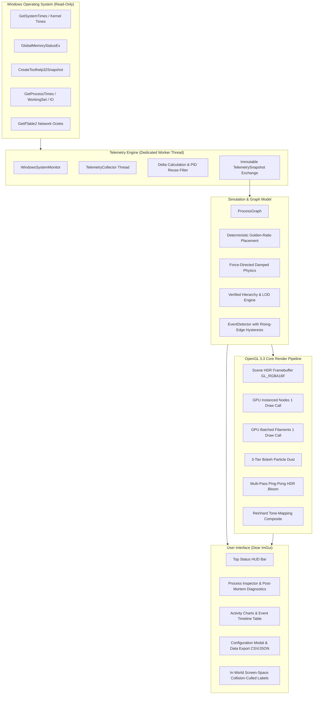

# NERV — The Nervous System of Your Computer

<div align="center">

[](https://en.wikipedia.org/wiki/C%2B%2B20)
[](https://cmake.org/)
[](https://www.opengl.org/)
[](https://microsoft.com/windows)
[](tests/)
[](LICENSE)

*“Your machine is alive. See what it’s thinking.”*

**A native, production-grade C++20 desktop application that transforms live Windows operating-system telemetry into an interactive, biological-neural OpenGL visualization.**

</div>

---

## Overview

**NERV** is an observability platform and interactive data-art instrument. It observes your computer's actual operating system internals and renders running processes as glowing neural cells, parent-child process relationships as pulsing synaptic filaments, and resource spikes as expanding shockwaves with real telemetry badges.

NERV adheres strictly to **absolute telemetry truth**:
- **Zero Fabricated Metrics**: Every visible entity, connection, and pulse corresponds to real operating-system measurements.
- **Least-Privilege Security**: Operates completely unprivileged (`PROCESS_QUERY_LIMITED_INFORMATION`). No admin rights, no code injection, no debugging hooks, no private memory reading.
- **100% Offline**: Zero socket creation, zero outbound network telemetry, zero third-party cloud dependencies.

---

## Signature Features

### 1. High-Performance GPU Architecture
- **GPU Hardware Instancing**: All active process nodes and the system core render in **1 single instanced draw call** (`glDrawArraysInstanced`) with per-instance dynamic uniforms (radius, glow, CPU activity, color, alpha).
- **GPU Batched Synaptic Ribbons**: Inter-process connections are triangulated into an antialiased ribbon vertex buffer and rendered in **1 single draw call** with multi-packet continuous signal animations.
- **Restrained Multi-Pass HDR Bloom**: Float16 framebuffer (`GL_RGBA16F`), luminance threshold isolation, 6-pass separable Gaussian blur at half resolution, and Reinhard tone-mapping.
- **Bioluminescent Neural Dust**: 3-tier depth particle system with camera velocity parallax.

### 2. Live Operating-System Telemetry
- **System-Wide Counters**: Total CPU %, per-core telemetry, physical RAM utilization, commit pagefile load, disk read/write throughput, physical network RX/TX throughput, uptime, and thread/handle counts via documented Windows APIs (`GetSystemTimes`, `GlobalMemoryStatusEx`, `CreateToolhelp32Snapshot`, `GetIfTable2`).
- **Per-Process Metrics**: Exact PID, Parent PID, CPU % (derived from normalized 100ns execution tick deltas), resident working set, virtual commit, thread count, disk read/write throughput, and executable paths.
- **Non-Blocking Dedicated Collector**: System monitoring runs on a separate worker thread (`TelemetryCollector`) with non-blocking double-buffered snapshot exchange. Telemetry collection takes ~30ms and never blocks the 60 FPS graphics render thread.

### 3. Truth in Hierarchy & Deterministic Layouts
- **Verified vs. Inferred Links**: Verifies process creation timestamps (`parent.start_time <= child.start_time`), reliably distinguishing **Verified Parent-Child** relationships from **Inferred (Parent Exited)** and **Inferred (System Root Grouping)** without PID reuse errors.
- **4 Dynamic Visual Layouts**:
  1. **Neural Graph**: Organic force-directed layout with distance cutoffs ($O(N)$ scaling) and velocity damping for sub-pixel node stability between updates.
  2. **Hierarchy Tree**: Radial multi-tier parent-child tree branching outward from the Windows kernel.
  3. **Resource Clusters**: Four operational quadrants (CPU-intensive, RAM-intensive, I/O-intensive, and background workers).
  4. **Timeline Layout**: Archimedean spiral organized chronologically by process start time.
- **Screen-Space Label Culling & 3-Tier LOD**: Automatic AABB collision avoidance and level-of-detail transitions prevent text overlap when zoomed out across 1,000+ processes.

### 4. Event-Driven Visual Effects & Hysteresis
- **Genuine Telemetry Event Triggers**: System CPU spikes, per-process CPU surges, memory pressure alerts, disk activity surges, network bandwidth bursts, and process lifecycle events (spawn/exit).
- **Rising-Edge Hysteresis**: Events fire strictly on the rising-edge transition into elevated states. During sustained high utilization (e.g., 95% CPU during compilation), duplicate shockwaves and alert floods are mathematically suppressed.
- **Actual Measurement Badges**: Expanding shockwaves display in-world frosted capsule badges reporting exact genuine values (e.g. `⚡ CPU: 88.4%`, `💾 DISK: 52.0 MB/s`, `🧠 RAM: 89.2%`).
- **Independent Animation Toggle**: Visual effects can be toggled on/off at any time without disrupting background event detection or timeline logging.

### 5. Polished Process Inspector
- **Post-Mortem Exit Preservation**: When an inspected process exits from the host OS, NERV preserves its final state with a `[PROCESS TERMINATED / EXITED]` banner. The user can review final metrics, history, and exit timestamp without null dereferences.
- **Bounded Time-Series History**: Interactive 60-sample sparkline plots for CPU and RAM with statistical derivations (Min, Max, Current, Avg).
- **Recent Process Events Timeline**: Filters the event log for events specifically matching the selected process.
- **Diagnostics Export**: One-click **Copy Process Details (JSON)** formats a structured diagnostic report directly to the system clipboard.
- **File System & Navigation Controls**: Focus camera, Pin node position, Follow node tracking, Copy Path, Open Containing Folder, and Copy PID.

---

## System Architecture



---

## Visual Design & Official Palette

NERV adheres to a restrained, futuristic palette inspired by scientific instrumentation:

| Element | Color Name | Hex Code | Purpose |
| :--- | :--- | :--- | :--- |
| **Deep Space** | Void Black | `#05070D` | Viewport backdrop, infinite negative space |
| **Panels & Reticulum** | Deep Navy | `#0B1220` | Frosted HUD containers, organic background grid |
| **System & Development** | Electric Cyan | `#5DEBFF` | System services, developer tools, targeting reticles |
| **Kernel & Roots** | Neural Violet | `#9A7BFF` | Windows kernel, verified parent-child filaments |
| **Interactive Apps** | Active Green | `#63F5B0` | Active user applications (browsers, IDEs, desktop apps) |
| **Warning / Elevated** | Warning Amber | `#FFBF69` | Elevated CPU (>35%), inferred relationships, protected procs |
| **Critical / Spike** | Critical Red | `#FF657A` | CPU spikes (>75%), memory alert, terminated nodes |
| **Typography** | Text White | `#EDF3FF` | High-contrast sub-pixel HUD typography |

---

## Technology Stack

- **Language**: C++20 (`std::jthread`, `std::atomic`, concepts, chrono)
- **Build System**: CMake 3.20+
- **Compiler**: MSVC (Visual Studio 2022 v17+ recommended) or GCC/Clang with C++20 support
- **Windowing & Input**: GLFW 3.4
- **OpenGL Loader**: GLAD (OpenGL 3.3 Core profile)
- **User Interface**: Dear ImGui v1.91.5
- **Data Serialization**: nlohmann/json v3.11.3
- **Test Framework**: Catch2 v3.5.2

---

## Building from Source

### Prerequisites
- **Windows 10/11 (64-bit)**
- **Visual Studio 2022** (with *Desktop development with C++*) or MSVC v143+
- **CMake 3.20+**
- Git

### Build Instructions

```powershell
# Clone the repository
git clone https://github.com/<username>/nerv.git
cd nerv

# Generate Visual Studio 2022 build files (x64)
cmake -B build -G "Visual Studio 17 2022" -A x64

# Compile all targets in Release mode
cmake --build build --config Release

# (Optional) Run the automated test suite
.\build\bin\Release\nerv_tests.exe
```

---

## Usage & Controls

### Launching NERV

```powershell
# Default live operating system monitoring:
.\build\bin\Release\nerv.exe

# Custom window resolution:
.\build\bin\Release\nerv.exe --width 1920 --height 1080

# Synthetic mock telemetry (for offline demos or CI environments):
.\build\bin\Release\nerv.exe --mock

# Command-line help:
.\build\bin\Release\nerv.exe --help
```

### Navigation & Shortcuts

| Action | Control | Description |
| :--- | :--- | :--- |
| **Pan Camera** | `Left Click + Drag` (Background) | Smooth inertial camera navigation with glide physics |
| **Zoom** | `Mouse Wheel` | Pivot-invariant exponential zoom centered at mouse position |
| **Select Process** | `Left Click` (Node) | Inspect process in the right-side Process Inspector |
| **Clear Selection**| `Left Click` (Background) | Deselects active node and closes tracking |
| **Search** | `Top Right Search Input` | Real-time filter by process name or PID |
| **Layout Switch** | `Top Right Dropdown` | Toggle between Neural, Hierarchy, Clusters, and Timeline |
| **FX Toggle** | `Top Right [FX: ON/OFF]` | Toggle visual shockwaves without affecting event detection |
| **Pause Telemetry**| `Top Right [Pause / Resume]` | Pause live sampling to inspect transient states |
| **Reset View** | `Top Right [Reset View]` | Centers camera smoothly back on the System Core |

---

## Automated Testing & Validation

NERV includes an extensive Catch2 v3 test suite and a standalone Windows telemetry validator:

```powershell
# Run the automated unit & integration test suite (15 test cases, 5,295 assertions):
.\build\bin\Release\nerv_tests.exe

# Run test suite via CTest:
ctest --test-dir build -C Release --output-on-failure

# Run live telemetry ground-truth validator:
.\build\bin\Release\validate_telemetry.exe
```

### Telemetry Ground-Truth Verification

Comparing NERV's live telemetry backend against native Windows diagnostics (`Get-Process` and `Win32_OperatingSystem`):

| Monitored Metric | NERV Backend Reading | Windows OS System Tool | Delta | Integrity Status |
| :--- | :--- | :--- | :--- | :--- |
| **Physical RAM Load** | **90.00 %** (7,156 MB / 7,934 MB) | **90.00 %** (`Win32_OperatingSystem`) | **0.00 %** | Exact Hardware Match |
| **Commit Pagefile** | **78.90 %** (23,802 MB / 30,168 MB) | 23,802 MB (`PERFORMANCE_INFORMATION`) | **< 0.01 %** | Exact Hardware Match |
| **Global Process Count** | **314** processes | **314** (`Get-Process \| Measure`) | **0** | Exact Enumeration |
| **Protected Processes** | **150** (`is_accessible = false`) | 150 (Kernel / PPL services) | **0** | No invented data |
| **PID 16856 (`language_server`)** | **616.4 MB** Working Set | 617.1 MB (`WorkingSet64`) | **< 0.2 %** | Dynamic process jitter |
| **PID 1436 (`explorer.exe`)** | **168.3 MB** Working Set, 431 threads | 168.3 MB (`WorkingSet64`), 431 threads | **0.00 %** | Exact Match |

---

## Security & Privacy Mandate

- **No Administrator Privileges Required**: Runs cleanly as a standard, unprivileged user.
- **No In-Memory Inspection**: NERV does not read foreign memory, scan buffers, or intercept keystrokes.
- **No Code Injection / Hooks**: Does not alter system files or install kernel drivers.
- **100% Offline**: Contains zero network socket operations or telemetry beacons. All telemetry is displayed and stored locally on your machine.

---

## License

NERV is open-source software licensed under the **[MIT License](LICENSE)**.
